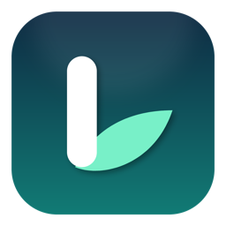
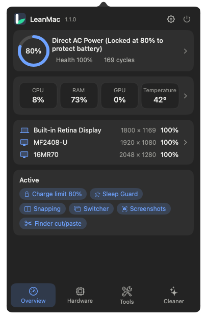
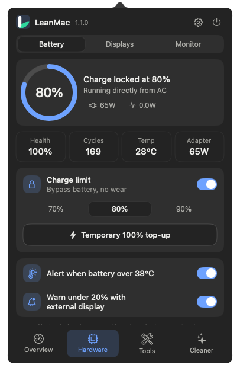
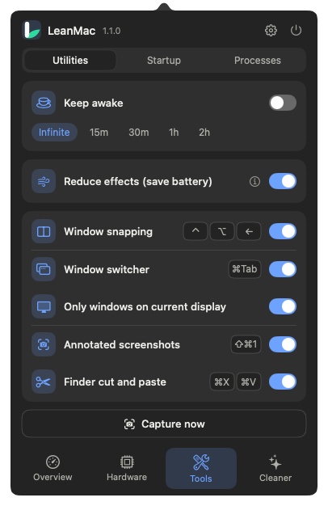
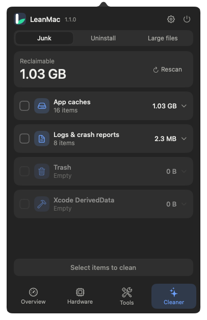

<div align="center">



# LeanMac

**One small menu bar app for the things your Mac should have done for you.**
Charge limit, window snapping, a better ⌘Tab, live system stats, screenshots and a safe cleaner, in plain Swift.

[](https://github.com/johnnychungg/LeanMac/releases/latest)
[](LICENSE)
[](#install)
[](#install)
[](Package.swift)
[](#privacy-and-trust)

[**Download the latest release**](https://github.com/johnnychungg/LeanMac/releases/latest) ·
[Features](#features) · [Install](#install) · [Build from source](#build-from-source) · [Contributing](#contributing)

<br>



</div>

## What is LeanMac?

LeanMac lives in your menu bar and replaces a handful of single-purpose utilities with one light app.
It is **open source and free forever**: no ads, no account, no subscription, no "pro" tier, no telemetry.

It is a **vibe-coded** project, built in the open for the Mac community. That makes honesty important, so the
[trust notes](#privacy-and-trust) below say plainly what it touches and what is still rough. Issues and pull requests
are very welcome.

## Features

<table>
<tr>
<td width="50%" valign="top">

### 🔋 Battery
- **Charge limit** (70 / 80 / 90 %): holds the battery at your limit and runs the Mac straight from AC, so a Mac that stays plugged in stops wearing the cell.
- **Temporary 100 % top-up** for the days you need a full battery, then it locks again by itself.
- **Battery calibration** on demand or periodically.
- Health, cycle count, battery temperature, adapter wattage and time remaining.
- Alerts when the battery runs hot, or drops below 20 % with an external display connected.
- A **safety watchdog**: if LeanMac is killed, the helper releases the lock by itself after about 30 seconds.

</td>
<td width="50%" valign="top">



</td>
</tr>
<tr>
<td width="50%" valign="top">



</td>
<td width="50%" valign="top">

### 🧰 Tools
- **Window snapping** with the keyboard, and moving windows between displays.
- **Window switcher** on ⌘Tab: several rows with live thumbnails, with the option to show only windows on the current display.
- **Keep awake** for 15 minutes up to infinite, plus a **Reduce effects** mode that turns off animations to save battery and heat.
- **Annotated screenshots** (⇧⌘1) and a Capture now button.
- **Finder cut and paste** (⌘X, ⌘V), which Finder never had.
- **Sleep Guard**: turns Bluetooth off when the lid closes and restores it on wake, so a sleeping Mac does not wake itself.
- **Startup items and processes**: switch off login items, and see which apps use the most energy.

</td>
</tr>
<tr>
<td width="50%" valign="top">

### 📊 Monitor
- CPU, RAM, GPU and temperature, each as its **own item in the menu bar** (pin only the ones you want).
- Disk, network, **fan speed** and per-sensor temperature in the Monitor tab.
- Fans are shown **read-only**. LeanMac never controls them.

### 🖥️ Displays
- Brightness, resolution and refresh rate for each connected display.
- Brightness keys (F1 / F2) act on the display under the cursor.

</td>
<td width="50%" valign="top">



</td>
</tr>
</table>

### 🧹 Cleaner
- **Junk**: app caches, logs and crash reports, Trash and Xcode DerivedData, listed with sizes. Folders macOS owns are hidden instead of being shown locked.
- **Uninstall**: removes an app together with its leftovers.
- **Large files**: finds what is eating your disk.
- Everything is moved to the **Trash**, so a mistake can be undone.

### ✨ And also
- **Signed, user-confirmed updates.** LeanMac tells you when a new version exists. It downloads and installs only after you press Install, and only if the download carries the maintainer's signature.
- **English and Vietnamese** interface (Tiếng Việt), with light, dark and automatic appearance.
- Small and quiet: it pauses sampling and background timers when the Mac sleeps.

**Deliberately left out** because they are risky or easy to get wrong: fan control, process freezing, virtual displays,
clipboard history, mouse chords, hiding menu bar icons, disk speed tests.

## Install

1. Download `LeanMac-x.y.z.zip` from the [latest release](https://github.com/johnnychungg/LeanMac/releases/latest) and unzip it.
2. Move **LeanMac.app** into `/Applications`.
3. **First launch.** LeanMac is signed with a self-signed identity and is **not notarized** (there is no paid Apple Developer account behind it), so macOS blocks the first start. Open **System Settings > Privacy & Security**, scroll down and press **Open Anyway**. If you prefer the terminal:
   ```bash
   xattr -dr com.apple.quarantine /Applications/LeanMac.app
   ```
4. Grant the permissions you want (below). Everything is optional; a feature without its permission simply stays off.

**Requirements:** macOS 14 Sonoma or newer, Apple Silicon.

**Updates.** Releases update themselves from the Settings page (once a day, can be turned off). Copies you build yourself
are signed with your own identity, so they cannot update in place; update those with `git pull` and a rebuild.

### Permissions

| Permission | Used for |
|---|---|
| Accessibility | Window snapping, the ⌘Tab switcher, Finder cut and paste, keyboard shortcuts |
| Screen Recording | Window thumbnails in the switcher, and screenshots |
| Bluetooth | Turning Bluetooth off when the lid closes (Sleep Guard) |
| Administrator password (once) | Installing the small helper that the charge limit needs |

## Privacy and trust

- **No telemetry, no accounts, no analytics.** The only network use is the optional update check against GitHub, at most once a day, with no identifiers ([ADR 0004](Docs/adr/0004-update-check.md)).
- **Updates are verified.** The update manifest is signed (Ed25519), the download is checked against its SHA-256, and the app bundle must match the running app's code signature. A downgrade is refused.
- **Privileged helper.** The charge limit writes to the SMC, which needs root. Installing it asks for your administrator password once and adds a small helper under `/Library/PrivilegedHelperTools/com.local.leanmac.*` and a sudoers rule limited to your user. The helper accepts a fixed set of commands. Without it, everything else still works. Details and the threat model: [SECURITY.md](.github/SECURITY.md).
- **Private macOS interfaces.** A few features use undocumented APIs that may break on any macOS update. They fail soft (the feature turns off). The list is in [Docs/third-party.md](Docs/third-party.md).
- **Honest status.** Battery behaviour (charge limit, calibration, sleep and wake) has been tested on a limited set of Macs. Watch the battery the first days and [report problems](https://github.com/johnnychungg/LeanMac/issues).
- **Display modes** are applied without an automatic revert. If a resolution leaves the screen unreadable, switch back in System Settings > Displays.

## Build from source

```bash
git clone https://github.com/johnnychungg/LeanMac.git && cd LeanMac
./Scripts/setup-signing-identity.sh   # once; keeps the Accessibility permission across rebuilds
./build.sh                            # builds, installs into /Applications and launches
./build.sh --dev --no-run             # contributor mode: no helper, no SMC writes
swift test                            # needs full Xcode
```

Requirements: macOS 14+, Xcode or the Command Line Tools, and OpenSSL 3 (`brew install openssl`) for the signing script.
Logs go to `~/Library/Logs/LeanMac/leanmac.log`. Architecture overview: [Docs/ARCHITECTURE.md](Docs/ARCHITECTURE.md).
Releasing: [Docs/releasing.md](Docs/releasing.md).

## Contributing

Bug reports, ideas and pull requests are welcome. Please read [CONTRIBUTING.md](.github/CONTRIBUTING.md) first, and the
[Code of Conduct](.github/CODE_OF_CONDUCT.md). Report security problems privately, as described in [SECURITY.md](.github/SECURITY.md).
Coding agents should start from [AGENTS.md](AGENTS.md). Translations live in `App/Bundle/Localization`.

## Acknowledgements

- The bundled `smc` command-line tool comes from [smcFanControl](https://github.com/hholtmann/smcFanControl), by devnull and Michael Wilber (GPL-2.0-or-later). See [Docs/third-party.md](Docs/third-party.md).
- Thanks to every Mac utility that showed what is possible from a menu bar.

## License

Copyright (C) 2026 Johnny Chung. Released under the [GPL-3.0-only](LICENSE) license, so it stays free for everyone.
